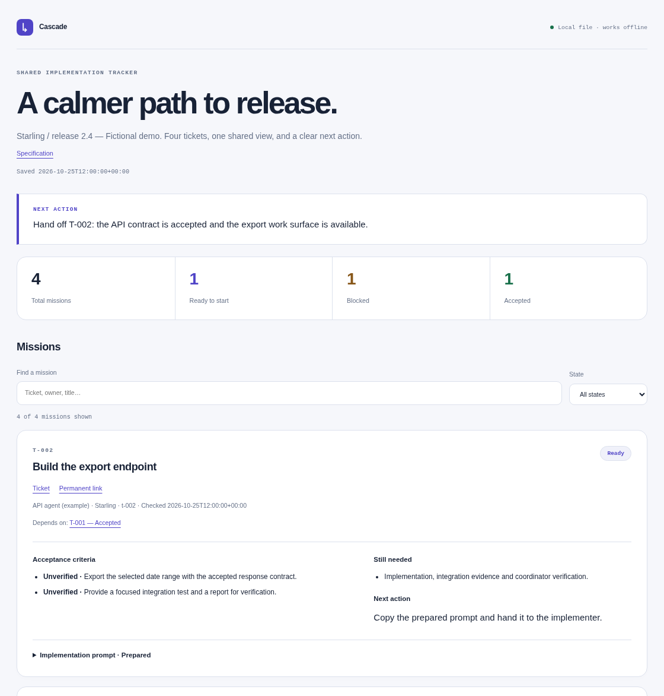

<p align="center"></p>

# Cascade

Un skill pour coordonner des tickets avec des agents : comprendre les dépendances, préparer des prompts précis, suivre les preuves et reprendre le travail après une interruption. Le tout s’appuie sur **un tracker HTML autonome**, consultable hors ligne.

[English](../README.md) · [Guide détaillé](guide.md) · [Démonstration](../examples/README.md) · [Instructions du skill](../SKILL.md)

## Ce qu’il apporte

- Une vue du travail prêt à démarrer, des dépendances et des blocages.
- Des prompts d’implémentation copiables et des relances ciblées sur les écarts observés.
- Un suivi par critère, avec responsable, conversation, preuves et prochaine action.
- Une distinction explicite entre préparation, envoi, exécution, tests, CI, déploiement et acceptation.
- Une reprise du contexte après interruption ou compaction.
- En option : réservation partagée, vérification de fraîcheur et restauration depuis un dépôt distant.

## Installer

Prérequis : **Python 3.11+ sur Linux, macOS ou WSL**. Aucune dépendance Python externe. Le lecteur HTML fonctionne aussi dans un navigateur Windows ; les scripts nécessitent un environnement POSIX.

Avec Node.js 22.20+, tu peux l’installer directement depuis le catalogue [skills.sh](https://skills.sh/nautalsoft/cascade/cascade) :

```bash
npx skills add nautalsoft/cascade --skill cascade
```

Choisis ton agent ; ajoute `-g` pour l’utiliser dans tous tes projets. Pour une installation sans Node.js, utilise le script Python :

```bash
git clone https://github.com/nautalsoft/cascade.git
cd cascade
python3 tools/install.py --dest "$HOME/.agents/skills/cascade"
```

Cette destination convient à Codex et aux hôtes découvrant `~/.agents/skills`. Pour Claude Code, choisis `~/.claude/skills/cascade` ; pour OpenCode, `~/.config/opencode/skills/cascade`. Le [guide](guide.md#agent-hosts) cite les documentations de ces hôtes et distingue compatibilité documentaire et vérification réelle.

L’installateur refuse d’écraser un dossier existant. Pour mettre à jour, installe une nouvelle copie et compare tes modifications avant de remplacer l’ancienne.

## Utiliser

Dans Codex :

```text
$cascade

Coordonne ces tickets : <URLs>.
Lis les instructions du dépôt et les dépendances actuelles.
Réutilise le tracker actif ou crée un tracker HTML stable.
Prépare les prompts des missions prêtes et donne-les-moi pour envoi.
Note les blocages, les preuves manquantes et la prochaine action utile.
```

Dans Claude Code, utilise `/cascade`. Dans les autres hôtes, demande le chargement du skill par son nom.

Les prompts utilisent `$implement` par convention. Ce skill d’implémentation n’est pas fourni : utilise le tien ou les instructions explicites de ton projet. Le suivi et la reprise fonctionnent sans lui.

## Voir le résultat sans agent

```bash
python3 examples/create_demo.py /tmp/orchestrate-demo
python3 scripts/tracker.py check /tmp/orchestrate-demo/tracker.html
```

Ouvre ensuite `/tmp/orchestrate-demo/tracker.html`. La démonstration contient quatre tickets fictifs, leurs dépendances et des prompts copiables. Aucun message n’est envoyé.

<p align="center"></p>

Pour un vrai projet, le flux de modification est `read → save → check`. Le navigateur affiche le tracker ; le script Python enregistre ses modifications avec contrôle de version. Les commandes et les champs sont décrits dans le [guide](guide.md#maintain-a-tracker).

## Aller plus loin

Commence par préparer et remettre les prompts. Si tu autorises la délégation, le skill utilise les outils disponibles dans ton environnement et son contrat de réservation. Si la perte de la machine doit être couverte, configure un dépôt opérationnel distinct, vérifie la publication et réalise une restauration à une autre racine.

Aucun compte, dépôt de récupération, calendrier ou envoi n’est configuré par l’installation. Les tickets et les preuves restent les sources de référence ; le tracker en conserve une lecture datée. Une validation locale ne prouve pas un déploiement ou une acceptation sur la cible.

## Contribuer

```bash
python3 -B tools/check.py
```

Voir [CONTRIBUTING.md](../CONTRIBUTING.md). Le projet est publié sous licence [MIT](../LICENSE), avec ses [crédits d’adaptation](../NOTICE.md).
